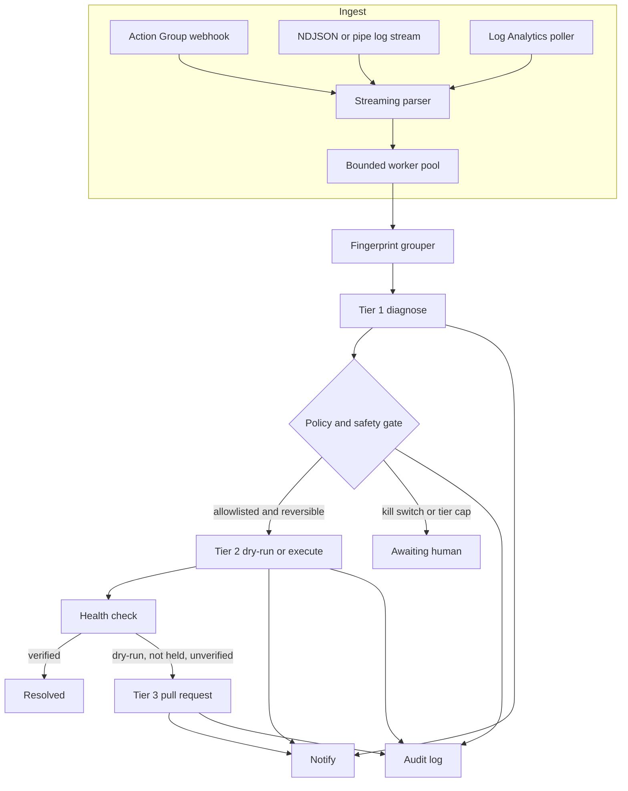

# Architecture

## Throughput

Log lines are scanned with `bufio.Scanner`. Each line is parsed into one reused `Signal` whose strings point at a single copied buffer (`BenchmarkParseLogLine` is 0 B/op). Before the signal is queued, `Detach` copies those strings so the next line can reuse the buffer.

`Fingerprint` normalizes the message in a pooled byte slice and hashes it with xxhash. Digits collapse to `#`. The resource ID is lowercased in that buffer only. The steady-state benchmark is 0 B/op.

The incident store has 32 shards. A repeat takes the shard lock, bumps the count, and returns a clone for the API. Diagnosis does not run again until the severity worsens or the count hits a notify milestone (1, 10, 50, 100 by default). That keeps a hot exception off the Azure and model path.

The diagnose pool is bounded. `POST /v1/ingest/logs` uses a blocking submit, so a slow diagnoser applies backpressure to the request body. `POST /v1/ingest/monitor` uses a non-blocking submit and returns 429 when the queue is full. Action Groups retry on that status.

Audit events for decisions are written before the call returns. A full async buffer, used when `audit.sync` is false, drops high-volume group events and records `audit.saturated` rather than blocking the parser. The demo sets `sync: true`.

## Decisions

The pipeline in `internal/pipeline` is the only place that orders the tiers:

1. Group the signal.
2. If it is new, worse, or a milestone, gather deployments and diagnose.
3. If the kill switch is on, stop.
4. If a tier-2 rule matches and the resource allows the tier, pick one catalog action and hand it to the executor.
5. If the outcome is `verified`, resolve the incident.
6. If a tier-3 rule matches the outcome and the resource allows tier 3, open one pull request.

A second signal for the same fingerprint does not open a second pull request.

## Providers

`platform.Runtime` is the Azure boundary. `internal/azure` implements it with the Azure SDK. `internal/platform/fake` implements it for the simulator and the tier tests. Diagnosis, remediation, and the poller depend on the interface, not on the SDK.

`fix.Provider` is the git boundary. `Memory`, `GitHub`, and `AzureDevOps` implement `Create`. None of them implement a merge.

`notify.Delivery` is the outbound boundary. Stdout, webhook, GitHub issues, and SMTP all take the same `Message`.
